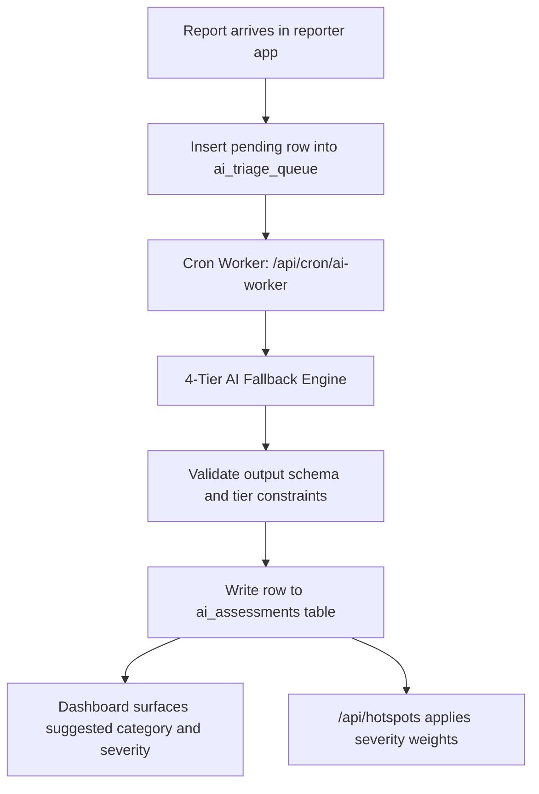

# AI in Kuuma Obutonde

**Status: Core fallback engine, database migrations, and observability modules implemented.** This document specifies how the AI triage subsystem operates, its four-tier fallback hierarchy, database schemas, anti-abuse protections, and operational metrics. It strictly follows the rules in [design-spec.md](design-spec.md) and our repository standards: human review, no auto-rejection, immutable audit trails, and whistleblower protection.

## Why

NEMA has few officers and many reports. Today officers read reports newest first and treat every report of one type the same: a small sewage drip and a burst sewer both count as "Sewage". The AI's purpose is to **ease that work**: it reads each report, judges **how severe** it is, puts the most serious ones in front of officers first, and uses that severity to show **which places are most affected**, so inspectors go where they are needed most. It also takes routine work off managers and admins (briefings, deadline lists, drafts) and watches for reward fraud, all without identifying reporters.

## The one rule

**The AI ranks and suggests. An officer decides.** The AI changes the order officers see things in and offers a suggestion. It never changes a report's status, category, next step, trust score or reward, and nothing it produces is evidence.

## Job 1: Triage by severity

When a report arrives, the AI reads it and gives it a **severity**:

| Severity | Meaning | Examples | Shown to officers |
| --- | --- | --- | --- |
| **Critical** | Serious harm happening now, to people, water or wildlife | Chemical or oil spill into a river, burst sewer into a channel, large fire, dead fish | Top of the list, red. Suggested category: Emergency |
| **High** | Ongoing damage NEMA should act on soon | Active filling or building in a wetland, a factory pipe discharging, large dumping site | Next. Suggested category: Enforcement |
| **Medium** | A real problem, not urgent | Blocked drainage, a rubbish heap, cut vegetation | After High |
| **Low** | Minor, or little to act on | Litter, an old or unclear photo, no visible problem | Last. May suggest Insufficient |

For each report it returns:

- **severity** (Critical, High, Medium, Low)
- a **suggested triage category** and **next step**, from the existing lists
- **confidence** (low, medium, high)
- a **short reason** that names what it saw, e.g. *"Dark liquid flowing from a pipe into an open channel; note says 'every morning'; 3 other reports within 300 m this week."*

**How this eases the work**

- The dashboard's report list is sorted **by severity, then by deadline**, instead of newest first. Officers start with what matters most.
- Critical reports get the Emergency deadline (inspection within 3 days) as soon as an officer confirms, and are flagged so they are never missed in a busy queue.
- Officers accept a suggestion with one click instead of working out the category from scratch. When they disagree, they pick something else as they do today.

**What it reads**

Photo, report type, note (Luganda, Kiswahili or English), GPS accuracy, photo source (camera or gallery), evidence signature status, duplicate result (`dup_status`, `case_id`), how many other reports are nearby in the last 14 days, and what is near the location (a river, wetland, school, market) when map data is available.

**What it never reads**: anything in `identity_vault` (phone numbers), the reporter's device key, or officer names.

**Rules**

- It never rejects, deletes or hides a report. A Low report still appears in the list and still reaches an officer.
- When it is unsure, it says *low confidence* and the report is placed by deadline as today, not pushed to the bottom.
- The reporter's trust level is **not** used to rate severity. Severity is about the damage in the report, not about who sent it, so a new reporter's report of a real spill ranks as high as anyone's.
- A gallery photo, a weak GPS fix or an unsigned report is shown to the officer as a warning, but does not lower severity on its own.

## Job 2: Find the most affected places (hotspots)

Today `lib/hotspots.js` weights each report by its **type** (Sewage 8, Rubbish 2, and so on). With the AI, each report is weighted by its **severity** instead, so the hotspot ranking reflects what is actually happening on the ground.

| Severity | Weight in hotspot score |
| --- | --- |
| Critical | 10 |
| High | 6 |
| Medium | 3 |
| Low | 1 |

Everything else in hotspot scoring stays as it is, because it already protects against unfair results:

- only reports an officer has **reviewed** count;
- reports lose half their weight every 14 days, so places improve when the problem stops;
- extra reports from the same phone count only 10%, and one reporter alone can never make a place red;
- reports without a severity (AI off, or low confidence) fall back to the type weights.

On top of the ranking, the AI writes a **short summary for each top hotspot**, for example: *"Lubigi channel near Nansana: 9 reports in 3 weeks, mostly sewage, 2 Critical. Getting worse since 1 November."* Inspectors use it to plan visits; managers use it to decide where to send people.

Oversight officers see the same ranking and summaries, built from **totals only**, never individual reports.

**How this eases the work**

- Instead of reading hundreds of reports to see patterns, officers and managers get a ranked list of the most affected places, with the reason in one line.
- Inspection trips can cover a whole hotspot (one case, many reports) instead of single reports.

## Job 3: Ease admin and dashboard work

Managers and admins spend time working out what is late, who should go where, and what to report upward. The AI prepares this; a person checks and acts.

| Task | What the AI does | Who decides |
| --- | --- | --- |
| **Daily briefing** | Each morning, one screen: new Critical and High reports, reports about to miss a deadline (by stage: acknowledge, triage, inspect, decide), hotspots that got worse, and claims waiting on a fraud check (see Rewards below) | Manager reads it; nothing changes automatically |
| **Assignment suggestions** | Suggests which inspector should take which report or hotspot, by area and current workload, grouping nearby reports into one trip | Manager accepts or reassigns. (Needs an assignment feature: inspectors and areas are not in the system yet.) |
| **Deadline nudges** | Lists reports likely to go overdue in the next 48 hours, most severe first | Officers |
| **Message drafts to reporters** | Drafts the short status update a reporter sees (Received, Inspector will visit, Referred, No action and why) in the reporter's language | Officer edits and sends; the AI never sends |
| **Monthly transparency report** | Drafts the figures the design spec asks for: reports received, time to acknowledge and triage, enforcement rate, false-report rate, by area. Built from totals only | Admin edits and publishes |
| **Staff requests** | Shows pending access requests at the top of the briefing | Admin approves or rejects; the AI never approves anyone |

## Rewards: right person, no fraud, no tracking

**What the AI does not do: identify or track the owner of a phone.** The reward token exists so the reporter can be paid **without** NEMA knowing who they are:

- The token is a random secret held only by the reporter's phone. The database stores a SHA-256 hash of it, which cannot be turned back into the token or linked to a person.
- Only the phone that sent the report can claim its reward, so the right person is paid without anyone being identified.
- The payout number is encrypted (AES-256-GCM) in `identity_vault`, apart from the report, and is used only to send airtime.

Tracking reporters would break the design spec's promise of reporter protection ("no retaliation, safe channels") and would need a new legal basis under the DPIA. Reporters of polluters, illegal builders and factories are exactly the people who need that protection.

**What the system can do: stop reward fraud without naming anyone.** Fraud here means one person farming airtime: many fake reports, many phones, one payout number. Checks run on patterns, not names:

| Check | How, without identifying anyone |
| --- | --- |
| **Same payout number on many claims** | Store a keyed fingerprint of the number (`phone_fingerprint`: HMAC-SHA-256 with its own secret, `PHONE_FINGERPRINT_KEY`) next to the encrypted number. Equal numbers give equal fingerprints, so claims can be counted per number without decrypting any. Today this is not possible: the encryption gives a different result every time. |
| **Many claims from one phone** | Count verified claims per device key per month |
| **Unusual bursts** | Many claims to one fingerprint, or from one area, in a short time |
| **False reports** | Phones whose reports were marked false (trust score already tracks this) |

When a check trips, the AI **holds the payout and explains why** in the daily briefing, e.g. *"One payout number has claimed for 7 different phones this month."* A person then decides: pay, or refuse. These checks are mostly plain rules; the AI's part is spotting unusual patterns the rules miss and writing the explanation.

**Who can ever see a phone number**

- Nobody on the dashboard. Officers, inspectors, admins and oversight never see payout numbers or fingerprints.
- The airtime payment step decrypts the number only to send airtime, and logs that it did.
- If a case goes to court and the law requires the reporter's identity, a `legal` officer requests it, an admin approves, and both are recorded in the audit log. This is a legal process, not an AI task.

## Supporting jobs (later)

These help officers read reports faster. They come after Jobs 1 and 2.

- **Translate notes** from Luganda and Kiswahili into English, shown next to the original and never replacing it. Machine translation is never evidence (design spec).
- **Check photos**: does the photo match the reported type; is it too dark or blurry; does it show faces or number plates that must be blurred before sharing outside NEMA.
- **Transcribe voice reports** from the planned toll-free phone line, with a confidence score per language and a human listener for low-confidence ones.

## What the AI must never do

| Never | Why |
| --- | --- |
| Reject, delete, close or hide a report | Design spec: no auto-rejection; every report reaches a person |
| Set the category, next step or status itself | Officers decide; the AI only suggests |
| Change trust scores or rewards | These follow officer decisions only |
| Use the reporter's trust level to rate severity | Severity is about the damage, not the person |
| See or send reporter identity (`identity_vault`, phone numbers, device keys) | Reporter protection |
| Identify, track or link a phone, token or payout number to a person | Reporter protection; the token exists so people can be paid without being identified |
| Refuse a reward, approve staff, assign work or send messages by itself | It holds, suggests and drafts; a person decides |
| Contact reporters | All messages to the public come from NEMA |
| Produce anything used as evidence | Evidence is the signed photo, location and time, and the inspector's findings |
| Be required for the system to work | If the AI is down, the list falls back to deadline order and hotspots to type weights |

## How it fits in



## Database Tables and Implementation

The database migration is defined in `db/migrations/20261115_ai_jobs_queue.sql`.

```sql
CREATE TABLE IF NOT EXISTS ai_triage_queue (
  id            bigserial PRIMARY KEY,
  report_id     text NOT NULL REFERENCES reports(id) ON DELETE CASCADE,
  status        text NOT NULL DEFAULT 'pending' 
                CHECK (status IN ('pending', 'processing', 'completed', 'failed')),
  tier_executed smallint CHECK (tier_executed BETWEEN 1 AND 4),
  attempts      int NOT NULL DEFAULT 0,
  max_attempts  int NOT NULL DEFAULT 3,
  locked_at     timestamptz,
  locked_by     text,
  last_error    text,
  created_at    timestamptz NOT NULL DEFAULT now(),
  updated_at    timestamptz NOT NULL DEFAULT now()
);

CREATE TABLE IF NOT EXISTS ai_assessments (
  id                 uuid PRIMARY KEY DEFAULT gen_random_uuid(),
  report_id          text NOT NULL REFERENCES reports(id) ON DELETE CASCADE,
  model_id           text NOT NULL,
  prompt_version     text NOT NULL,
  severity           text CHECK (severity IN ('Critical', 'High', 'Medium', 'Low')),
  suggested_category text CHECK (suggested_category IN ('Emergency', 'Enforcement', 'Referral', 'Duplicate', 'Insufficient')),
  suggested_outcome  text CHECK (suggested_outcome IN ('Inspector will visit', 'Referred to another agency', 'Need more information')),
  confidence         real NOT NULL CHECK (confidence BETWEEN 0.0 AND 1.0),
  urgency_score      real NOT NULL CHECK (urgency_score BETWEEN 0.0 AND 1.0),
  key_evidence_tags  text[] DEFAULT '{}',
  reason             text NOT NULL,
  officer_action     text DEFAULT 'pending' CHECK (officer_action IN ('pending', 'accepted', 'overridden', 'dismissed')),
  actioned_at        timestamptz,
  actioned_by        text REFERENCES staff_users(email) ON DELETE SET NULL,
  tier_executed      smallint NOT NULL,
  latency_ms         int,
  is_latest          boolean NOT NULL DEFAULT true,
  created_at         timestamptz NOT NULL DEFAULT now()
);
```

## Four-Tier Fallback Engine (`lib/ai/fallbackEngine.js`)

To guarantee 100 percent operational uptime even during external network outages or quota exhaustion:
- **Tier 1 (Cloud Multimodal)**: Google Gemini 2.5 Flash free tier, evaluating photo and multilingual text within an 1,800 ms timeout.
- **Tier 2 (Decoupled Local Model)**: Local or containerized INT8 quantized model (MobileNetV4 + AfriBERTa) running on CPU with zero external network dependencies.
- **Tier 3 (Deterministic Heuristics)**: Luganda and English regular expressions matching critical terms (obutwa, amakolero, kazambi, obukyafu, lutobazi, kasasiro).
- **Tier 4 (Type Weight Baseline)**: Deterministic SLA and hotspot type weights from `lib/sla.js` and `lib/hotspots.js`.

Testing the AI engine:
```bash
npm test tests/ai_engine.test.mjs
```

When the officer triages, the audit log also records whether they **accepted** or **overrode** the suggestion. That makes the measurements below possible.

## Measuring it

The point is to save officer time without missing anything serious. Measure before and during the pilot:

| Measure | Target |
| --- | --- |
| **Time from receipt to triage** (pilot metric), with and without AI, especially for Critical reports | Clearly shorter |
| **Inspector hours per verified case** (pilot metric) | Lower |
| **Missed emergencies:** reports officers marked Emergency that the AI rated Medium or Low | Close to zero |
| **Agreement:** how often officers accept the suggested category | Tracked per category; low agreement means turn that suggestion off |
| **Hotspot check:** do inspectors confirm a real problem at the top-ranked places? | Most top-5 hotspots confirmed |
| **Admin time:** hours per week managers spend on status checks, assignment and monthly figures | Lower |
| **Reward holds:** share of held payouts that a person then refused | High; if most holds are paid anyway, the checks are too strict |
| **Bias audit** (design spec): severity and agreement split by note language, area (urban/rural, Lubigi vs. other sites) and reporter trust level | No large gaps |

Review a sample of overridden suggestions every month. If missed emergencies appear or a bias gap shows up, switch the AI ordering off for that category or area; the system keeps working without it.

## Data protection

- Sending report photos and notes to an outside AI provider is a new data flow. It must be in the **DPIA** and approved under the MoU before the pilot (design spec, Governance).
- Use a provider that does not train on submitted data and keeps nothing after answering, or run the model on NEMA-controlled hosting.
- Remove location data embedded in the photo file (EXIF) before sending; the model gets the reported location as a separate field.
- The API key lives in the server's environment settings, like `DATABASE_URL`, never in the code.

## Build order

1. **Severity triage** (Job 1): assessments table, sorted list, suggestion on the report, accepted/overridden in the audit log, and the measurements.
2. **Severity-weighted hotspots** (Job 2), then hotspot summaries.
3. **Daily briefing and deadline nudges** (Job 3), then message drafts and the monthly transparency report.
4. **Reward fraud checks**: add `phone_fingerprint` to `identity_vault` before rewards are paid out in the pilot, then the pattern checks and payout hold.
5. **Assignment suggestions**, once inspectors and areas are added to the system.
6. **Translation and photo checks.**
7. **Voice transcription**, together with the phone line.
