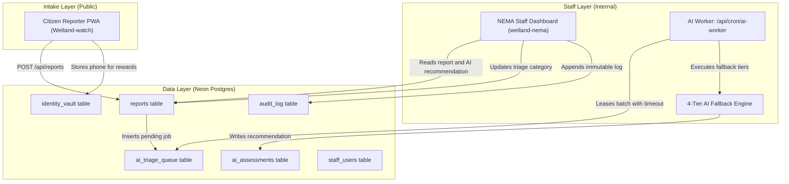
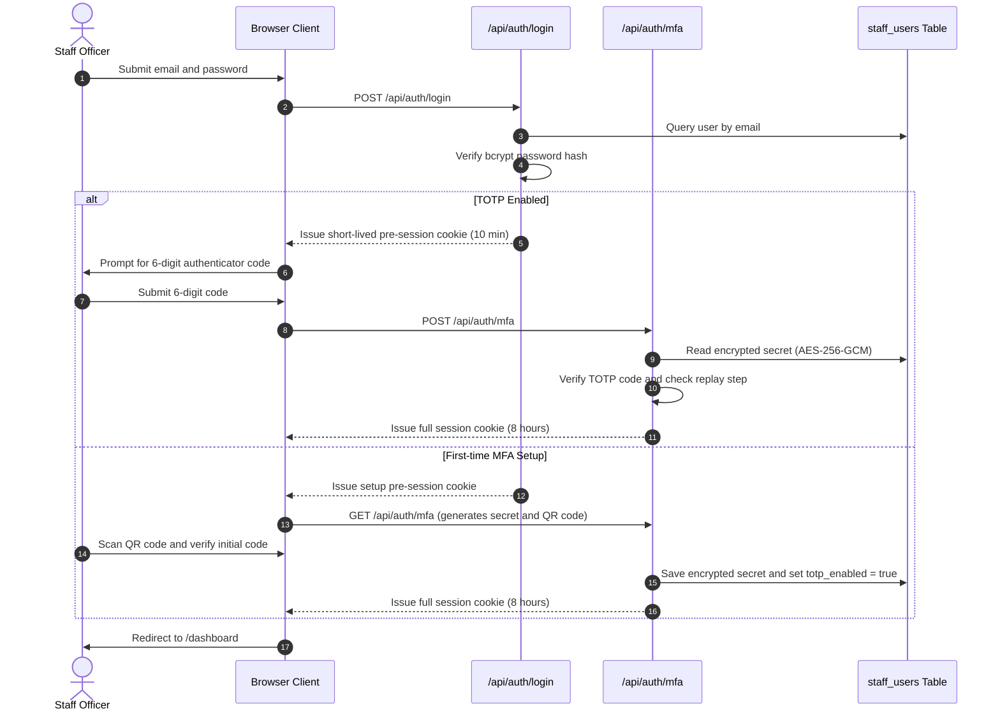
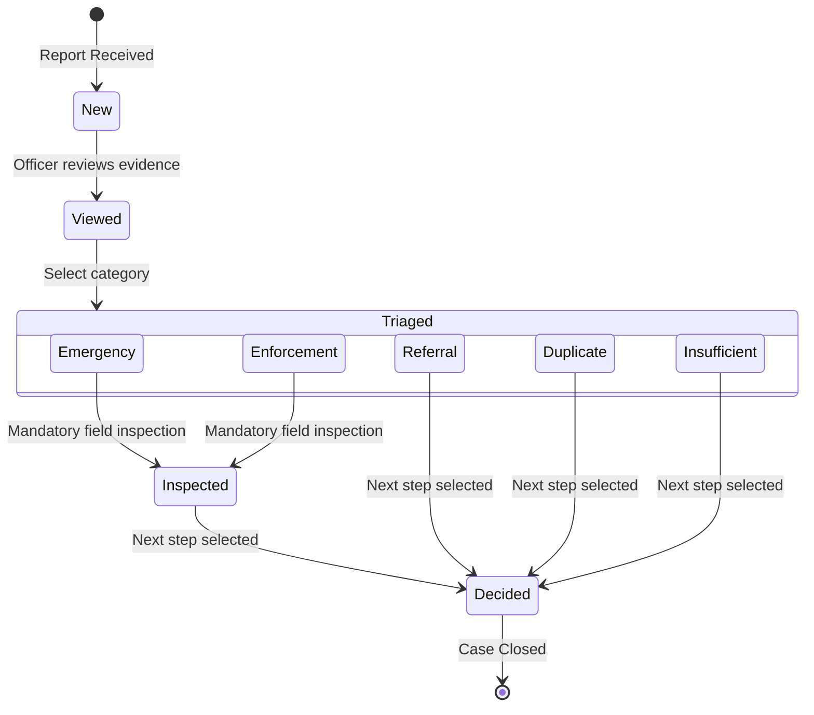
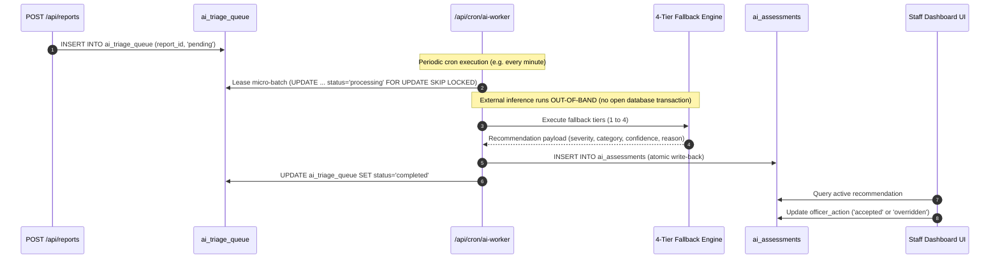

# System Architecture

This document provides a comprehensive technical overview of Kuuma Obutonde, detailing the data contracts, authentication protocols, statutory report lifecycles, and asynchronous processing pipelines across both applications.

---

## 1. Multi-Application Ecosystem

The platform separates public incident intake from internal staff triage. The components do not communicate via direct HTTP calls; they synchronize exclusively through a shared PostgreSQL data plane.

### Data Boundary and Ownership Invariants
- **Public Domain**: The reporter app (`Wetland-watch`) owns initial report creation and citizen reward identity. Personal identifiers are restricted to `identity_vault`.
- **Administrative Domain**: The staff dashboard (`wetland-nema`) owns review fields (`status`, `viewed_at`, `reviewed_by`, `triage_category`, `triaged_at`, `inspected_at`, `outcome`, `decided_at`) and all staff authentication records.
- **Audit Domain**: `audit_log` is append-only. Staff actions (triage, inspection, outcome updates, and account modifications) are committed within the same database transaction as the underlying change.

---

## 2. Staff Authentication and Session Lifecycle

Staff authentication requires two-factor authentication (TOTP) to protect sensitive environmental enforcement records.

### Authentication Invariants
- Session tokens are cryptographically signed with HS256 using `SESSION_SECRET`.
- Cookies enforce `httpOnly: true`, `sameSite: "strict"`, and `secure: true` in production.
- Failed login attempts trigger an exponential backoff lock in memory after 5 consecutive failures.
- `proxy.js` intercepts unauthenticated requests to protected paths (`/dashboard`, `/hotspots`, `/admin`), redirecting officers to `/login`.

---

## 3. Statutory SLA Lifecycle and State Machine

Report progression is governed by the state machine in `lib/sla.js`, enforcing statutory timelines under the National Environment Act of Uganda.

### Statutory Deadlines from Time of Receipt
1. **Acknowledgement Stage**: Due within 2 days. Marked as viewed by an authorized officer.
2. **Triage Stage**: Due within 7 days. Assigned an operational category (Emergency, Enforcement, Referral, Duplicate, Insufficient).
3. **Inspection Stage**:
   - Emergency category: Due within 3 days.
   - Enforcement category: Due within 30 days.
4. **Final Regulatory Decision**: Due within 45 days. Outcome selected (Inspector will visit, Referred to another agency, Need more information).

---

## 4. AI Triage Queue and Micro-Transaction Engine

The background AI triage subsystem runs asynchronously without blocking HTTP report ingestion or holding database locks during external inference.

### Transaction Isolation Rule
Connection poolers (such as Neon pgbouncer) terminate long-running idle transactions. Therefore, queue leasing, model inference, and assessment write-back are separated into three discrete micro-transactions:
1. **Lease Transaction** (under 15 milliseconds): Selects and locks pending rows using `FOR UPDATE SKIP LOCKED`.
2. **Out-of-Band Execution** (1 to 10 seconds): Performs multimodal inference or local fallback without holding database connections.
3. **Write-Back Transaction** (under 15 milliseconds): Writes the assessment record and marks the queue entry completed.

---

## 5. Hotspot Scoring Algorithm

Hotspots are computed server-side in `lib/hotspots.js` to surface regional environmental degradation clusters:

1. **Eligibility Filter**: Only reviewed reports with GPS accuracy of 250 meters or better are included.
2. **Spatial Partitioning**: Coordinates are mapped into 500-meter grid squares.
3. **Temporal Decay**: Reports decay exponentially, losing 50 percent of their weight every 14 days.
4. **Anti-Sybil Damping**: Additional reports from the same device public key in the same grid square count for only 10 percent of their normal weight. A single reporter can never trigger a critical (red) hotspot alone.
5. **Score Tiers**:
   - Score under 4: Hidden from summary list.
   - Score 4 to 7: Low priority (yellow).
   - Score 8 to 15: Medium priority (orange).
   - Score 16 and above: Critical priority (red).
